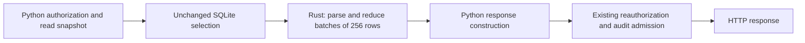

# First Rust server slice: training history reduction

The optional Rust reducer accelerates the history replay used by the reading
room, quiz completion checks and staff progress report. Python remains the
default. This is an incremental server migration; production cutover and the
rest of the server remain open in [RS-01–04](../../ROADMAP.md#rust-server-migration).

## Measurements and scope

Measured November 1, 2026 on the office Mac (8 logical CPUs, 16 GiB RAM).
The initial 30.25-second passive sample was taken on v0.19.1. CPU percentages
below are percentages of **one core**, not shares of the entire host:

| Observable process group | Mean CPU | Peak observed RSS |
|---|---:|---:|
| Serving API, including its background tasks | 10.96% | 256 MiB |
| Separate PostgreSQL processes | 54.25% | 468 MiB summed |
| Development processes | 62.04% | 3,319 MiB summed |

Whole-host CPU averaged 51.65% across all eight cores. The process census is
incomplete: inaccessible processes, newly started or exited processes, and
kernel work are not fully attributed. Summed RSS can count shared pages twice.
The production application uses embedded SQLite; the separate PostgreSQL group
is not its production database. This sample does not isolate individual API
background jobs or establish which group causes peak overload.

Read-only SQLite inspection found 230,491 events, a 286.39 MiB database and a
5.39 MiB WAL. Counting events took 4.41 ms wall / 3.74 ms CPU; grouping by event
type took 57.65 / 56.15 ms. The health/audit query plan scans the events table.
Five loopback `/health` calls all returned HTTP 200 and ready/current checks:
202–498 ms, median 259 ms. Five calls cannot establish a reliable production
p95 or error rate. Concurrent API background work is included in sampled
process CPU; these are not isolated per-request CPU measurements.

A separate 20-second disk sample after another deployment advanced the Mac to
v0.19.2 recorded 146.77 MiB read / 0.05 MiB written by the API, 91.41 / 9.13 MiB
by development processes, and 0.08 / 1.98 MiB by PostgreSQL. Whole-host disk
traffic was 293.50 / 26.86 MiB. These are macOS process physical-I/O counters,
not SQLite logical page reads. They are not simultaneous with the first CPU
sample and include only accessible surviving processes. API jobs, query cache
effects and export work are not separated. The later host sample had 3.55 GiB
available and 5.27 GiB swap allocated; allocation alone is not a paging rate.

Synthetic profiling of 108,000 page/video events identified JSON decoding and
per-event interval processing as substantial Python work. The original reducer
took about 442 ms wall / 438 ms CPU with minimal event payloads. That justified
moving this pure computation first. It does not establish history replay as the
largest contributor to whole-host overload. Richer event envelopes are used in
the acceptance benchmark below, so compare its paired results, not those two
different fixtures.

Operator evidence is kept under `.context/rust-server/`: `passive-baseline.json`,
`database-baseline.json`, `health-baseline.json`, `io-qualified.json`, profiling
and benchmark reports. These are local diagnostic artifacts, excluded from
releases. No staff identities or event payloads were copied into the baseline.

## Boundary and compatibility



Rust receives selected row values and item metadata. It owns no database
connection, path, credentials, writer, network operation or background job.
Python retains SQL selection, snapshots, authorization and all durable effects.
Parsing and final interval merging release the GIL. Extraction and small state
updates run with the GIL; this is not a claim of completely parallel replay.
Input batching is bounded, while accumulated coverage still grows with history,
as in the reference implementation.

Page sets, interval union and the existing half-second tolerance are preserved.
Python's floating-point summation remains the final watched-time operation so
rounding cannot change quiz completion at a threshold. The reference parser
handles unusual historical JSON, including non-finite values and large integers.
Unusual item metadata selects Python before consuming the cursor. Recovered
text timestamps retain Python's comparison and failure behavior, and ignored
evidence does not inspect timestamps or request payloads. Malformed history
never becomes a successful partial result.

The original Python hot loop remains intact for rollback. A helper refactor
was measured to add overhead and was removed from that path.

## Performance acceptance

Targets were recorded before implementation:

- At least 30% lower median wall time **and** process CPU for roster replay,
  including SQLite selection and the Python/Rust boundary.
- Reader replay no slower by more than the greater of 10% or 2 ms.
- Peak Rust worker RSS no greater than Python plus 32 MiB on the same fixture.
- Identical result digests, plus detailed compatibility tests; speed alone fails
  acceptance if behavior changes.

Final paired results on macOS arm64 / Python 3.13.15:

| Measurement | Python | Rust | Result |
|---|---:|---:|---|
| Roster median wall | 590.34 ms | 295.71 ms | 49.9% lower |
| Roster median process CPU | 588.64 ms | 295.12 ms | 49.9% lower |
| Reader median wall | 11.95 ms | 6.27 ms | 47.5% lower |
| Peak roster worker RSS | 49.34 MiB | 38.61 MiB | 10.73 MiB lower |

All four resource gates passed and every paired result digest matched. See
`.context/rust-server/benchmark-final/report.json` for raw samples. The test
started with 44.6% host CPU; observed CPU during the short run was 44.8–72.7%,
with no sustained five-second breach of the 70% guard. This remains a shared-host
measurement; rerun on a quiet candidate host before production acceptance.

The benchmark uses 50 readers × 2,160 events, two items per reader, realistic
synthetic event envelopes, fresh worker processes, one discarded warm-up and
seven runs in alternating backend order. Workers run sequentially. It measures
replay, not HTTP capacity, media conversion, Google latency or end-user p95.

## Build and reproduce

The crate, locked dependencies and Python wheel metadata live in
[`native/progress`](../../native/progress/README.md). It uses PyO3's CPython 3.11+
stable ABI. Build a separate wheel for each operating system and architecture;
the macOS arm64 wheel cannot run on Linux or Intel macOS. Rust 1.98.1 is pinned
in `rust-toolchain.toml`; normal Python installations need no Rust compiler.

In a development checkout with the project's test dependencies installed:

```sh
# Run builds and rehearsals sequentially, preferably away from the serving Mac.
CARGO_BUILD_JOBS=1 nice -n 10 .venv/bin/python -m pip wheel --no-deps ./native/progress --wheel-dir .context/rust-wheels
# Install the wheel matching this host from .context/rust-wheels.
.venv/bin/python -m pip install --no-deps .context/rust-wheels/postern_progress_native-0.1.0-cp311-abi3-macosx_11_0_arm64.whl
POSTERN_PROGRESS_BACKEND=rust nice -n 10 .venv/bin/python -m pytest tests/native tests/postern/test_progress_backend.py tests/postern/test_progress.py tests/postern/test_training_progress.py -q
nice -n 10 .venv/bin/python -m scripts.progress_benchmark --output .context/progress-benchmark
```

Use a fresh output directory for each benchmark. It creates synthetic SQLite
data and accepts no production database, URL or credentials. Stop local load
checks when host CPU reserve falls below 30% or production health degrades;
the reducer benchmark itself does not monitor production health. Use the
[capacity harness](capacity.md) for separately guarded HTTP/load rehearsals.

The workload flags are `--readers` (default 50, range 1–500),
`--events-per-reader` (default 2,160, range 1–2,880) and `--runs`
(default 7, range 3–30 measured runs, plus one discarded warm-up).
The product of readers and events per reader must not exceed 1,000,000.
Keep these inputs identical when comparing backends; changing the fixture
requires a fresh baseline. `--output` is required and must not already exist.

Native checks (run from `native/progress`, with the workspace Python selected
through `PYO3_PYTHON` if needed):

```sh
cargo fmt --check
CARGO_BUILD_JOBS=1 cargo clippy --locked --all-targets -- -D warnings
CARGO_BUILD_JOBS=1 cargo test --locked
```

CI runs the complete macOS suite with both backends, and the differential native
suite on Linux with Python 3.11 and 3.13. A configured CI job is not a passed run.
The Rust macOS job retains the exact wheel it installed and tested as
`progress-native-macos-arm64` for fourteen days. Download it only from a successful
run bound to the intended release commit, verify its filename/platform and
SHA-256, and retain that provenance with the release. This lets the serving Mac
install a tested wheel without compiling it locally.
Linux reducer portability does not make the macOS converter sandbox portable;
production Linux hosting still requires a separately verified isolation and recovery plan.

## Implementation validation, November 1

- 87 focused Python tests passed against the built native extension: deterministic
  and randomized differential replay, malformed history, metadata fallback,
  roster/coverage selection, authorization and restart rollback. Existing score
  and unlock assertions and deadlines remain unchanged.
- The two new v0.19.2 required-training report tests passed with Rust in a clean
  overlay of release commit `f07f862b824e583cbf5059c25f907e8739c7b4b1`. The
  implementation was developed on v0.19.1; this separately checks the newer
  consumer that shipped during the work.
- Three Rust unit tests, formatting and Clippy with warnings denied passed.
  The locked dependency graph's OSV scan reported no known vulnerabilities at
  the time checked. The installed extension's bytes match the built wheel;
  source/wheel hashes are retained in `.context/rust-server/build-manifest.json`.
- Release packaging/link checks passed (21 tests). A temporary Git index included
  new files for this check; the user's real index was unchanged. The native source,
  lockfile and build metadata are included. Actionlint and offline Zizmor passed.
- Independent native review found an eager timestamp conversion incompatible
  with recovered text timestamps. It is fixed and covered by regression tests.
  Its follow-up review found no remaining production blocker; a further integer
  precision suggestion was also applied and tested. This was an in-host review,
  not an independent-model review.

Candidate `d2a08d4318d6106358d460c747ab8a2b76b10d48` passed
[hosted run 41357469563](https://github.com/nerdymatters/postern/actions/runs/41357469563):
892 tests with default Python (six expected native-wheel skips), all 967 tests
with Rust enabled, 70 native tests on each Linux Python version, all 372 frontend
tests and the status-worker checks/build. Rust format, Clippy and three unit
tests also passed. The final release must have checks bound to its own revision.
Broad local runs were stopped for host contention and do not count as full-suite
passes; the latest stopped after 515 passes with no failure. Existing dependency
deprecation warnings remain.

## Cutover and rollback

`POSTERN_PROGRESS_BACKEND=python` is the default. Explicit `rust` selection
requires an installed module with API version 1; a missing or incompatible
module, or an invalid setting, fails startup before the database writer starts.
Runtime native errors propagate; there is no silent retry returning less data.

Before a production pilot:

1. Obtain green CI for both backends on the release candidate, retain its exact
   source revision, locked dependencies and wheel SHA-256, and repeat the
   benchmark on a quiet host. Confirm the wheel's platform and Python ABI.
2. Follow the [release and backup procedure](release.md). Preserve the live
   database, current activity, configuration, private training and branding.
   Install the optional wheel in the candidate environment and validate
   `POSTERN_PROGRESS_BACKEND=rust` there before switching the serving service.
3. Set `POSTERN_PROGRESS_BACKEND` in the existing API job's persistent environment.
   For launchd, back up that exact plist, preserve its label and other settings,
   and update its `EnvironmentVariables` entry. Reload the job definition with
   the appropriate privileges: after setting `DOMAIN`, `LABEL` and `PLIST` to
   the verified existing values, run `launchctl bootout "$DOMAIN/$LABEL"`, wait
   for the old API process to exit, then `launchctl bootstrap "$DOMAIN" "$PLIST"`.
   Do not start a second writer or overwrite the plist with a generic installer.
   Verify the loaded job's backend environment and replacement process. A shell
   `export`, SIGTERM/KeepAlive, or `kickstart -k` alone does not load an edited
   plist; those restarts are suitable only when the job environment is unchanged.
4. Check `/health`, reading-room progress, quiz locking, staff report access,
   revocation/recovery refusals and certificate attribution with a controlled
   account. Compare request errors, p50/p95, audit queue/commit latency and
   CPU/RSS against the same workload before cutover. Stop the pilot for any
   compatibility mismatch, health failure or material resource regression.
5. Roll back by persisting `POSTERN_PROGRESS_BACKEND=python` and reloading the
   same job definition as in step 3 against the **current** database. Verify
   the loaded environment is Python; health alone does not identify the backend.
   Recheck health and activity
   recorded during the Rust window. This slice has no schema migration and
   needs no database restore; restoring an older backup would lose new activity.

The disposable-data rehearsal starts Python, restarts with Rust, records new
page activity and a first exam pass/saved certificate name, then closes and
reopens the service with Python. It checks page coverage, certificate number,
award time and name, unchanged durable event bytes and unchanged schema.
Production cutover has not been performed for this slice.

## Remaining performance work

Keep the health/audit full-table scan and development-process contention ahead
of expanding the Rust boundary. Measure the exact health query under a fixed
history size, investigate its query/index or publication-watermark contract,
and preserve fail-closed backup/audit readiness. Separately move broad builds
and tests to dedicated runners, or schedule
bounded runs in a quiet window. Do not terminate unrelated user jobs.

RS-01 still needs representative request p95/error rates, audit queue/commit
latency and background-job attribution. Run those larger rehearsals away from
the overloaded serving host. A faster reducer does not remove expensive SQL,
conversion work or competing development processes.
