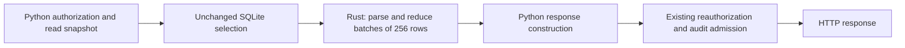

# First Rust server slice: training history reduction

The optional Rust reducer accelerates the history replay used by the reading
room, quiz completion checks and staff progress report. Python remains the
default. This is an incremental server migration; production cutover and the
rest of the server remain open in [RS-01–04](../../ROADMAP.md#rust-server-migration).

## Measurements and scope

Measured November 1, 2026 on the office Mac (8 logical CPUs, 16 GiB RAM).
The initial 30.25-second passive sample was taken on v0.19.1. CPU percentages
below are percentages of **one core**, not shares of the entire host:

| Observable process group | Mean CPU | Peak observed RSS |
|---|---:|---:|
| Serving API, including its background tasks | 10.96% | 256 MiB |
| Separate PostgreSQL processes | 54.25% | 468 MiB summed |
| Development processes | 62.04% | 3,319 MiB summed |

Whole-host CPU averaged 51.65% across all eight cores. The process census is
incomplete: inaccessible processes, newly started or exited processes, and
kernel work are not fully attributed. Summed RSS can count shared pages twice.
The production application uses embedded SQLite; the separate PostgreSQL group
is not its production database. This sample does not isolate individual API
background jobs or establish which group causes peak overload.

Read-only SQLite inspection found 230,491 events, a 286.39 MiB database and a
5.39 MiB WAL. Counting events took 4.41 ms wall / 3.74 ms CPU; grouping by event
type took 57.65 / 56.15 ms. The health/audit query plan scans the events table.
Five loopback `/health` calls all returned HTTP 200 and ready/current checks:
202–498 ms, median 259 ms. Five calls cannot establish a reliable production
p95 or error rate. Concurrent API background work is included in sampled
process CPU; these are not isolated per-request CPU measurements.

A separate 20-second disk sample after another deployment advanced the Mac to
v0.19.2 recorded 146.77 MiB read / 0.05 MiB written by the API, 91.41 / 9.13 MiB
by development processes, and 0.08 / 1.98 MiB by PostgreSQL. Whole-host disk
traffic was 293.50 / 26.86 MiB. These are macOS process physical-I/O counters,
not SQLite logical page reads. They are not simultaneous with the first CPU
sample and include only accessible surviving processes. API jobs, query cache
effects and export work are not separated. The later host sample had 3.55 GiB
available and 5.27 GiB swap allocated; allocation alone is not a paging rate.

Synthetic profiling of 108,000 page/video events identified JSON decoding and
per-event interval processing as substantial Python work. The original reducer
took about 442 ms wall / 438 ms CPU with minimal event payloads. That justified
moving this pure computation first. It does not establish history replay as the
largest contributor to whole-host overload. Richer event envelopes are used in
the acceptance benchmark below, so compare its paired results, not those two
different fixtures.

Operator evidence is kept under `.context/rust-server/`: `passive-baseline.json`,
`database-baseline.json`, `health-baseline.json`, `io-qualified.json`, profiling
and benchmark reports. These are local diagnostic artifacts, excluded from
releases. No staff identities or event payloads were copied into the baseline.

## Boundary and compatibility



Rust receives selected row values and item metadata. It owns no database
connection, path, credentials, writer, network operation or background job.
Python retains SQL selection, snapshots, authorization and all durable effects.
Parsing and final interval merging release the GIL. Extraction and small state
updates run with the GIL; this is not a claim of completely parallel replay.
Input batching is bounded, while accumulated coverage still grows with history,
as in the reference implementation.

Page sets, interval union and the existing half-second tolerance are preserved.
Python's floating-point summation remains the final watched-time operation so
rounding cannot change quiz completion at a threshold. The reference parser
handles unusual historical JSON, including non-finite values and large integers.
Unusual item metadata selects Python before consuming the cursor. Recovered
text timestamps retain Python's comparison and failure behavior, and ignored
evidence does not inspect timestamps or request payloads. Malformed history
never becomes a successful partial result.

The original Python hot loop remains intact for rollback. A helper refactor
was measured to add overhead and was removed from that path.

## Performance acceptance

Targets were recorded before implementation:

- At least 30% lower median wall time **and** process CPU for roster replay,
  including SQLite selection and the Python/Rust boundary.
- Reader replay no slower by more than the greater of 10% or 2 ms.
- Peak Rust worker RSS no greater than Python plus 32 MiB on the same fixture.
- Identical result digests, plus detailed compatibility tests; speed alone fails
  acceptance if behavior changes.

Final paired results on macOS arm64 / Python 3.13.15:

| Measurement | Python | Rust | Result |
|---|---:|---:|---|
| Roster median wall | 590.34 ms | 295.71 ms | 49.9% lower |
| Roster median process CPU | 588.64 ms | 295.12 ms | 49.9% lower |
| Reader median wall | 11.95 ms | 6.27 ms | 47.5% lower |
| Peak roster worker RSS | 49.34 MiB | 38.61 MiB | 10.73 MiB lower |

All four resource gates passed and every paired result digest matched. See
`.context/rust-server/benchmark-final/report.json` for raw samples. The test
started with 44.6% host CPU; observed CPU during the short run was 44.8–72.7%,
with no sustained five-second breach of the 70% guard. This remains a shared-host
measurement; rerun on a quiet candidate host before production acceptance.

The benchmark uses 50 readers × 2,160 events, two items per reader, realistic
synthetic event envelopes, fresh worker processes, one discarded warm-up and
seven runs in alternating backend order. Workers run sequentially. It measures
replay, not HTTP capacity, media conversion, Google latency or end-user p95.

## Build and reproduce

The crate, locked dependencies and Python wheel metadata live in
[`native/progress`](../../native/progress/README.md). It uses PyO3's CPython 3.11+
stable ABI. Build a separate wheel for each operating system and architecture;
the macOS arm64 wheel cannot run on Linux or Intel macOS. Rust 1.98.1 is pinned
in `rust-toolchain.toml`; normal Python installations need no Rust compiler.

In a development checkout with the project's test dependencies installed:

```sh
# Run builds and rehearsals sequentially, preferably away from the serving Mac.
CARGO_BUILD_JOBS=1 nice -n 10 .venv/bin/python -m pip wheel --no-deps ./native/progress --wheel-dir .context/rust-wheels
# Install the wheel matching this host from .context/rust-wheels.
.venv/bin/python -m pip install --no-deps .context/rust-wheels/postern_progress_native-0.1.0-cp311-abi3-macosx_11_0_arm64.whl
POSTERN_PROGRESS_BACKEND=rust nice -n 10 .venv/bin/python -m pytest tests/native tests/postern/test_progress_backend.py tests/postern/test_progress.py tests/postern/test_training_progress.py -q
nice -n 10 .venv/bin/python -m scripts.progress_benchmark --output .context/progress-benchmark
```

Use a fresh output directory for each benchmark. It creates synthetic SQLite
data and accepts no production database, URL or credentials. Stop local load
checks when host CPU reserve falls below 30% or production health degrades;
the reducer benchmark itself does not monitor production health. Use the
[capacity harness](capacity.md) for separately guarded HTTP/load rehearsals.

The workload flags are `--readers` (default 50, range 1–500),
`--events-per-reader` (default 2,160, range 1–2,880) and `--runs`
(default 7, range 3–30 measured runs, plus one discarded warm-up).
The product of readers and events per reader must not exceed 1,000,000.
Keep these inputs identical when comparing backends; changing the fixture
requires a fresh baseline. `--output` is required and must not already exist.

Native checks (run from `native/progress`, with the workspace Python selected
through `PYO3_PYTHON` if needed):

```sh
cargo fmt --check
CARGO_BUILD_JOBS=1 cargo clippy --locked --all-targets -- -D warnings
CARGO_BUILD_JOBS=1 cargo test --locked
```

CI runs the complete macOS suite with both backends, and the differential native
suite on Linux with Python 3.11 and 3.13. A configured CI job is not a passed run.
The Rust macOS job retains the exact wheel it installed and tested as
`progress-native-macos-arm64` for fourteen days. Download it only from a successful
run bound to the intended release commit, verify its filename/platform and
SHA-256, and retain that provenance with the release. This lets the serving Mac
install a tested wheel without compiling it locally.
Linux reducer portability does not make the macOS converter sandbox portable;
production Linux hosting still requires a separately verified isolation and recovery plan.

## Implementation validation, November 1

- 87 focused Python tests passed against the built native extension: deterministic
  and randomized differential replay, malformed history, metadata fallback,
  roster/coverage selection, authorization and restart rollback. Existing score
  and unlock assertions and deadlines remain unchanged.
- The two new v0.19.2 required-training report tests passed with Rust in a clean
  overlay of release commit `f07f862b824e583cbf5059c25f907e8739c7b4b1`. The
  implementation was developed on v0.19.1; this separately checks the newer
  consumer that shipped during the work.
- Three Rust unit tests, formatting and Clippy with warnings denied passed.
  The locked dependency graph's OSV scan reported no known vulnerabilities at
  the time checked. The installed extension's bytes match the built wheel;
  source/wheel hashes are retained in `.context/rust-server/build-manifest.json`.
- Release packaging/link checks passed (21 tests). A temporary Git index included
  new files for this check; the user's real index was unchanged. The native source,
  lockfile and build metadata are included. Actionlint and offline Zizmor passed.
- Independent native review found an eager timestamp conversion incompatible
  with recovered text timestamps. It is fixed and covered by regression tests.
  Its follow-up review found no remaining production blocker; a further integer
  precision suggestion was also applied and tested. This was an in-host review,
  not an independent-model review.

The [v0.20.0 release](https://github.com/nerdymatters/postern/releases/tag/v0.20.0)
at merged commit `83f0aa3e88552a74686ecce9f20724236d418d3c` passed
[hosted run 41362837319](https://github.com/nerdymatters/postern/actions/runs/41362837319):
892 tests with default Python (six expected native-wheel skips), all 967 tests
with Rust enabled, 70 native tests on each Linux Python version, all 372 frontend
tests and the status-worker checks/build. Rust format, Clippy and three unit
tests also passed. The reviewed PR head passed its own six-lane run before merge.
Broad local runs were stopped for host contention and do not count as full-suite
passes; the latest stopped after 515 passes with no failure. Existing dependency
deprecation warnings remain.

## Release and office staging

On November 1, the office API was upgraded to that exact merged v0.20.0 commit
after private configuration, training and branding backups and a checked SQLite
backup. All 15 installed preflight checks passed; local/public API health and
protected-route refusal checks passed. The existing service label and settings
were preserved, with **Python still active**. Live event count and maximum
sequence matched the pre-switch snapshot; no older database was restored.

The release includes the CI-tested macOS arm64 / CPython 3.11+ stable-ABI wheel,
its provenance and checksums. The wheel SHA-256 is
`a06d3e103d2f9935773421bed01b587e6518d307d2734545bf3e980533a28304`.
The installed binary matches that wheel, and Rust API version 1 was verified in
a separate process without constructing a Service or starting another writer.
Vercel also recorded a successful production deployment of the merged commit.

This completes release preparation and office staging, not production Rust
acceptance. A quiet-host benchmark, administrator-assisted activation,
controlled staff-account journey and live rollback remain. The November 1
session lacked administrator authentication and browser access; API health is
not proof of a fresh sign-in or end-to-end browser behavior. Operator evidence
and the exact existing-job handoff are retained privately in `.context/rust-ship/`.

## November 2 pilot preparation and query attribution

Read-only checks reconfirmed the installed v0.20.0 commit, native binary hash,
Rust API version 1 import, dependency consistency and ready local API health.
The serving process remains on Python. Administrator authentication was still
unavailable; no job definition, serving process, live query or index was changed.

A 30.4-second passive sample averaged 20.3% whole-host CPU. Accessible process
groups averaged 6.83% of one core for the API, 5.82% for the separate PostgreSQL
processes and 16.22% for development processes. These group values are not shares
of the whole eight-core host and do not account for all processes or kernel work.
They are a new observation, not a controlled before/after comparison.

The quiet-window rule was recorded before the acceptance attempt: six consecutive
five-second samples at or below 20% whole-host CPU. The bounded three-minute wait
did not qualify (maximum observed sample 61.7%), so no benchmark workload started.
The four resource targets remain unchanged. A future attempt must also check
staff activity and API health; the private guard stops a running benchmark for
CPU above 70%, failed/timed-out health checks or its 120-second wall limit.

After that wait ended, three bounded read-only SQL probes confirmed the current
health plan scans all 230,727 events and looks up their batches by primary key.
Its median wall/CPU time was 164.1/163.6 ms. Reading the latest confirmed export
took 5.6 ms over 66,279 batches. Three subsequent loopback health requests all
returned ready HTTP 200, with median wall time 236.9 ms. These are sequential
small samples with cache and background-work effects; they do not establish a
representative p95, error rate, isolated per-request CPU or causal percentage.

This confirms a material SQL cost to investigate alongside the Rust pilot.
Evaluate query/index candidates on synthetic histories, including unbatched,
unconfirmed and orphaned batch references, and measure their audit-write cost
before making a production change. The existing left join includes all three
cases; an optimization must preserve that pending-event meaning. Broader audit
queue and background-job attribution remains open. Sanitized measurements are
retained privately in `.context/rust-pilot-20261102/`.

The operator later became available at the office Mac. Four further three-minute
watches still found no qualifying quiet window, so none started the synthetic
workload. The operator confirmed that the Python reading room opens with correct
existing progress and quiz locks. The last full watch began after the operator
reported the Mac idle; CPU ranged from 15.9% to 67.8%, with only three consecutive
qualifying samples. Repeated local attempts stopped without relaxing the rule.
The later user-requested retry below passed; broader attribution of the recurring
load remains open.
Read-only
preflight again verified release, dependencies, wheel, service identity and
local/public health. A private Terminal pilot helper passed nine disposable
controller checks, including failed-start recovery, refusing a second writer,
preserving other job settings and detecting changed activity after rollback.
It has not been used to change the service. Evidence and the prepared helper
are in `.context/rust-live-20261102/`; subsequent watches are in its sibling
directories with suffixes `-retry1`, `-retry2` and `-retry3`. Administrator
authentication and Rust/rollback staff results remain pending. Python remains
active; no new live backup,
backend change or live rollback was performed during this preparation.

## Quiet-host acceptance, November 2

A subsequent user-requested retry passed the unchanged quiet rule: six consecutive
five-second whole-host CPU samples at or below 20%. The qualifying samples were
14.4%, 15.3%, 14.9%, 18.9%, 15.3% and 16.9%. It used the installed v0.20.0 source
and released native wheel, with the same synthetic fixture of 50 readers × 2,160
events, one discarded warm-up and seven measured runs per backend and scope.

| Measurement | Python | Rust | Result |
|---|---:|---:|---|
| Roster median wall | 558.46 ms | 287.65 ms | 48.5% lower |
| Roster median process CPU | 557.53 ms | 287.23 ms | 48.5% lower |
| Reader median wall | 10.88 ms | 5.65 ms | 48.1% lower |
| Peak worker RSS across measured samples | 48.98 MiB | 38.47 MiB | 10.52 MiB lower |

All four performance gates passed; the fourteen retained Python/Rust result pairs
have identical digests, and the benchmark also asserted parity on warm-up pairs.
Whole-host CPU during the eight sampled seconds was 18.8–27.3%. Health checks
before, during and after returned ready in 209, 202 and 212 ms respectively.
The serving Python PID was unchanged. A subsequent read-only pilot preflight
again verified the release, dependency lock plus native wheel, installed binary,
service identity, protected-route refusals and ready local/public health.

This qualifies the synthetic reducer benchmark, not HTTP capacity, production
p95 or live Rust behavior. The reading-room baseline on Python was confirmed
by the operator. Evidence is in `.context/rust-live-20261102-retry4/`. The first
subsequent live attempt is recorded below; full acceptance remains open.

## First live pilot, November 2

The operator ran the prepared command locally and supplied administrator
authentication on the Mac. A fresh private configuration/training/plist backup
and integrity-checked SQLite backup preceded activation. The existing job was
reloaded with Rust, and its persistent, loaded and process backend were verified.
Local/public startup health passed. The first monitored observation recorded
15% host CPU, 224 ms local health and 249.67 MiB API RSS.

A subsequent local health request hit the unchanged two-second socket timeout
while the helper was waiting for the Rust staff check. This was a health-monitor
exception, distinct from the three-minute operator-input deadline. The helper
automatically persisted Python and reloaded the same job against the current
database. It verified Python identity, local/public health, protected-route
refusals and unchanged configuration, branding, training and private Git settings.
No database restore was performed. A separate post-stop check reconfirmed Python
and local/public health; six paced Python health requests all passed in 195–235 ms.

The operator reported no visible problem, but the helper stopped before recording
the Rust staff result or taking the new-activity digest for comparison across
rollback. Its original `activity_preserved: false` meant that comparison was not
performed; it was not a finding of lost data. Keep RS-04 open. Activation and
rollback mechanics were exercised, while complete live compatibility acceptance
and the cause of the health delay remain unresolved.

Production runs with access logging disabled, and the existing error log had no
new entries during this attempt. There is no request-timing trace establishing
whether the delay came from SQL, scheduling or other work. The known health-query
scan is an investigation target, not a proven cause of this timeout. Do not raise
the timeout merely to obtain a passing pilot.

The original helper and journal are preserved in
`.context/rust-live-20261102/first-live-attempt/`. The current private helper now
names a health timeout explicitly and records an unperformed activity comparison
as unknown, with the same limits and rollback behavior. All eleven disposable
controller checks pass. No further production change was made during diagnosis.

## Health and export index candidate, November 4

Public main v0.21.0 adds Staff progress filtering, sorting and reporting. The
resource API, native reducer and dependency lock are unchanged from v0.20.0.
The migration workspace was synchronized before this candidate was prepared.

The reproduced cost is repeated scanning of historical event payloads and
completed export batches. Health queries pending event metadata; the exporter
polls every three seconds even when caught up. Three additive indexes retain
the existing SQL and readiness meaning:

- `events(batch_id,seq,ts)` covers health metadata and finds unbatched events in
  sequence order; it also selects a batch's summary events.
- A partial `batches(created_at)` index contains only batches with no confirmation
  or an unfinished summary. Completed history adds no idle selection scan.
- `batches(confirmed_at)` supports the latest confirmed export lookup.

A preregistered synthetic comparison used 240,000 events, 70,000 batches and
roughly 1 KiB payloads. Seven alternating paired runs followed a discarded
warm-up, with fresh query connections. Results matched for every query.

| Median measurement | Before | Candidate |
|---|---:|---:|
| Pending-health query wall / CPU | 129.72 / 129.58 ms | 62.40 / 62.35 ms |
| Latest confirmed export wall | 4.36 ms | 0.12 ms |
| Pending batch selection wall | 7.87 ms | 0.20 ms |
| Unbatched event selection wall | 66.82 ms | 0.15 ms |
| Batch summary selection wall | 71.87 ms | 0.15 ms |
| Single audit transaction wall / CPU | 4.87 / 0.24 ms | 4.97 / 0.63 ms |
| Seal 500 events wall / CPU | 6.58 / 2.12 ms | 7.24 / 2.67 ms |

Health wall and CPU improved about 52%, meeting the preselected 50% target.
Single-write wall overhead was about 0.10 ms (2%), within max(20%, 1 ms).
Index maintenance adds about 0.39 ms CPU per single write; sealing a 500-event
batch adds about 0.66 ms wall (10%). Index construction took 206 ms on this
fixture and added 7.58 MiB. These are paired local synthetic results, not live
HTTP p95 or a capacity claim. Health still scans all event metadata in a smaller
covering index; this does not make its cost independent of history size.

The unchanged-query plans explain the gains. Regression checks exercise real
`Service.health()` and `Service.export()`: missing/unconfirmed/orphan batches
remain pending, confirmed-but-unsummarized batches retain their prior meaning,
confirmation/deletion changes remain visible, and a legacy database gains the
indexes without changing activity. An instruction budget detects full-history
idle export scans without relying on machine-speed thresholds. Both regressions
fail against the unindexed code and pass with the candidate.

A disposable old → candidate → old → candidate writer rehearsal preserved all
event rows and activity recorded after indexing. The previous release could
append another event, and the final database passed `integrity_check`. Rollback
keeps the current database and can leave the additive indexes in place; restoring
an old backup would discard newer activity. Index creation runs during normal
startup, so production rollout must retain a checked backup and measure startup
on the actual database. No application timeout or audit deadline was increased.

Private experiment receipts are under
`.context/health-investigation-20261104/`: `acceptance.md`,
`index-probe/report.json`, `probe-guard.json`, `seal-probe.json`,
`regression-before.log`, `regression-after.log`, and `rollback-probe.json`.
The synthetic query experiment stayed below its host-load limit and production
health remained ready. Later broader local checks were stopped by their host
CPU guard (72.9%, then 91.2%), before a completed test verdict. An old private
validation wrapper also selected a previous checkout; its output cannot validate
this candidate. The private wrapper now binds imports to the checkout being validated, and
its focused check passes. The new regressions also pass directly against the
candidate under both Python and Rust, with two passes each. Full candidate validation and
production index rollout remain required; do not count interrupted or incorrectly
bound checks as passing evidence.

The earlier Rust pilot's two-second timeout remains unattributed. This change
removes a demonstrated recurring cost but is not proof that the timeout is
fixed. Deploy and observe the indexes with Python first, repeat the quiet-host
benchmark with the verified release, then complete the Rust staff check and
new-activity comparison across rollback under the existing health limits.

## Cutover and rollback

`POSTERN_PROGRESS_BACKEND=python` is the default. Explicit `rust` selection
requires an installed module with API version 1; a missing or incompatible
module, or an invalid setting, fails startup before the database writer starts.
Runtime native errors propagate; there is no silent retry returning less data.

Before a production pilot:

1. Obtain green CI for both backends on the release candidate, retain its exact
   source revision, locked dependencies and wheel SHA-256, and repeat the
   benchmark on a quiet host. Confirm the wheel's platform and Python ABI.
2. Follow the [release and backup procedure](release.md). Preserve the live
   database, current activity, configuration, private training and branding.
   Install the optional wheel in the candidate environment and validate
   `POSTERN_PROGRESS_BACKEND=rust` there before switching the serving service.
3. Set `POSTERN_PROGRESS_BACKEND` in the existing API job's persistent environment.
   For launchd, back up that exact plist, preserve its label and other settings,
   and update its `EnvironmentVariables` entry. Reload the job definition with
   the appropriate privileges: after setting `DOMAIN`, `LABEL` and `PLIST` to
   the verified existing values, run `launchctl bootout "$DOMAIN/$LABEL"`, wait
   for the old API process to exit, then `launchctl bootstrap "$DOMAIN" "$PLIST"`.
   Do not start a second writer or overwrite the plist with a generic installer.
   Verify the loaded job's backend environment and replacement process. A shell
   `export`, SIGTERM/KeepAlive, or `kickstart -k` alone does not load an edited
   plist; those restarts are suitable only when the job environment is unchanged.
4. Check `/health`, reading-room progress, quiz locking, staff report access,
   revocation/recovery refusals and certificate attribution with a controlled
   account. Compare request errors, p50/p95, audit queue/commit latency and
   CPU/RSS against the same workload before cutover. Stop the pilot for any
   compatibility mismatch, health failure or material resource regression.
5. Roll back by persisting `POSTERN_PROGRESS_BACKEND=python` and reloading the
   same job definition as in step 3 against the **current** database. Verify
   the loaded environment is Python; health alone does not identify the backend.
   Recheck health and activity
   recorded during the Rust window. This slice has no schema migration and
   needs no database restore; restoring an older backup would lose new activity.

The disposable-data rehearsal starts Python, restarts with Rust, records new
page activity and a first exam pass/saved certificate name, then closes and
reopens the service with Python. It checks page coverage, certificate number,
award time and name, unchanged durable event bytes and unchanged schema.
A brief production activation was rolled back during the first live pilot above;
the sustained production rollout remains pending.

## Remaining performance work

Validate and roll out the health/export index candidate before expanding the
Rust boundary. It reduces metadata scan cost but does not establish the cause
of the stopped live pilot. Preserve fail-closed backup/audit readiness and
measure production behavior before another Rust cutover. Separately move broad builds
and tests to dedicated runners, or schedule
bounded runs in a quiet window. Do not terminate unrelated user jobs.

RS-01 still needs representative request p95/error rates, audit queue/commit
latency and background-job attribution. Run those larger rehearsals away from
the overloaded serving host. A faster reducer does not remove expensive SQL,
conversion work or competing development processes.
